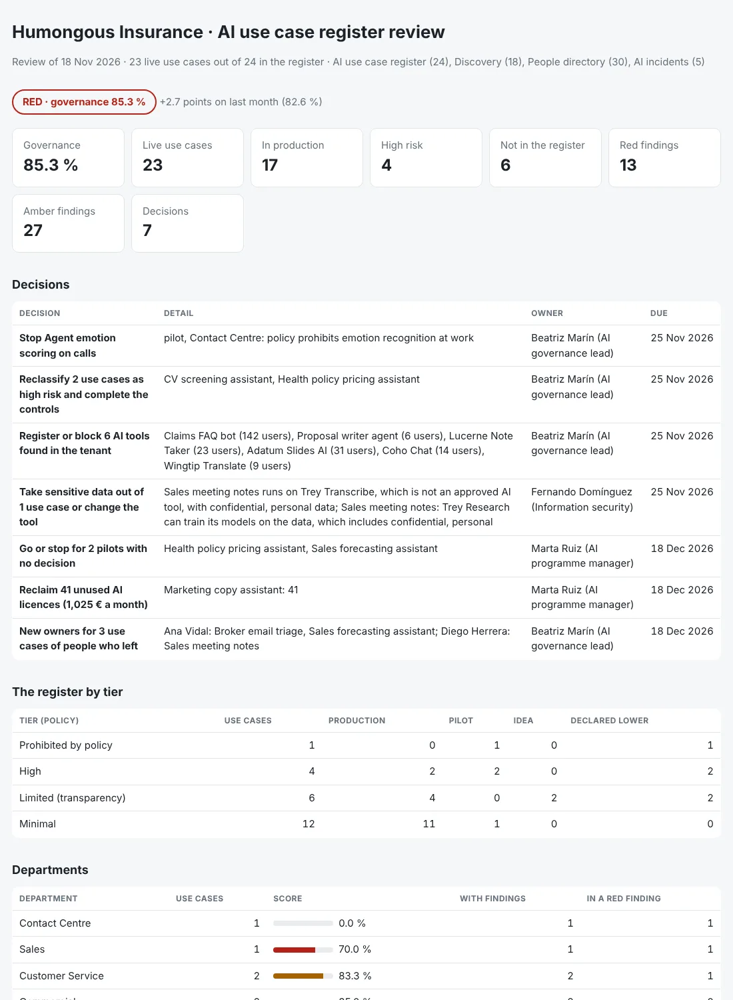

# AI Use Case Register Review

The question for the AI governance lead and the committee every month: do we know what AI is in use, is each use case in the right risk tier, and does it have the controls that tier needs? From the AI use case register, what discovery finds in the tenant (enterprise apps, Copilot Studio agents, cloud app discovery), the people directory with the AI training dates, the AI incidents and the organisation's AI policy, it puts together:

- **Register:** AI in use that nobody registered (shadow AI), entries with gaps, and use cases owned by people who left.
- **Risk:** the tier the policy gives each use case against the one declared, practices the policy prohibits, and AI incidents still open or that came after the last review.
- **Controls:** what each tier needs (human oversight, DPIA, risk assessment, test evidence, logging, vendor DPA, transparency notice, an owner with current AI training) and reviews on time.
- **Data and vendors:** data classes in a tool not approved for them, and vendors that can train their models on the data.
- **Value:** pilots with no decision, production with no business case, licences nobody uses and hours saved far below the estimate.

Every finding has an owner and a due date, every use case and department gets a **governance score**, the choices (what to stop, what to reclassify, what to register or block, where the data goes, which pilots go live, which licences to reclaim) become **decisions**, and `committee-pack.md` is the page for the monthly AI governance committee.

Python 3.10+, standard library only. It runs with fictional demo data out of the box. A read-only PowerShell script lists the enterprise apps in Entra ID that look like AI tools.

It sits next to [44-m365-copilot-readiness](https://github.com/inigogonzalezgarcia/44-m365-copilot-readiness), which gets the tenant ready for Copilot, and [25-security-controls-evidence](https://github.com/inigogonzalezgarcia/25-security-controls-evidence), which keeps the evidence of the security controls.



## Why

AI arrives in a company faster than the register that is supposed to track it:

- a team builds a Copilot Studio agent for its colleagues, 140 people use it and nobody registered it;
- a note-taking app is consented by twenty people and records calls with clients;
- a CV screening assistant is registered as low risk because the form asked who uses it, not what it decides;
- a pilot that scores how stressed the contact-centre agents sound is running, and the policy does not allow it;
- the chatbot on the website has no notice that it is a bot, and a wrong answer about cover has been open for four weeks;
- a pricing pilot has been running for five months with no decision;
- two thirds of the licences of a writing tool are not used.

Each tool shows its own part. The review reads them together against the policy and turns the result into a short list of fixes and decisions. The policy is in `settings.json`; the rules are in `aireg/checks.py`.

## What it checks

| Area | Code | Finding | Severity |
|---|---|---|---|
| Register | REG-UNREGISTERED | AI tool or agent in use with no entry | AMBER (RED with many users or sensitive data) |
| Register | REG-MISSING, REG-OWNER-LEFT | Owner, purpose, tool, data, tier or audience empty; owner disabled or gone | AMBER (RED if high risk) |
| Risk | RISK-PROHIBITED | The area is one the policy does not allow | RED |
| Risk | RISK-TIER | Declared in a lower tier than the policy gives it | AMBER (RED if high) |
| Risk | RISK-INCIDENT, RISK-REVIEW-AFTER | AI incident open too long; incident after the last review | AMBER (RED if high); AMBER |
| Controls | CTRL-MISSING | A control its tier needs is missing | AMBER (RED if high and in production) |
| Controls | CTRL-REVIEW | Review overdue for its tier, or never reviewed | AMBER (RED if high) |
| Data and vendors | DATA-TOOL, DATA-VENDOR | Tool not approved, or not for that data; vendor can train on sensitive data | AMBER or RED; RED |
| Value | VAL-PILOT, VAL-NO-CASE, VAL-ADOPTION, VAL-SHORTFALL | Pilot with no decision; no business case; low adoption; hours saved below the estimate | AMBER |

The tiers follow a risk-based approach (prohibited, high, limited with transparency, minimal), but what falls in each tier and which controls each one needs are the organisation's own policy in `settings.json`. The review does not decide whether a law applies to a use case and is not legal advice. [docs/data-format.md](docs/data-format.md) has every rule, column, setting and how the score is calculated.

## Outputs

| File | What |
|---|---|
| `report.html` | Score with its trend, tiles, the decisions, the register by tier, departments by score, every finding by area, AI in use that is not in the register, reviews due and value |
| `committee-pack.md` | One page for the AI governance committee: result, headlines, decisions, tiers, departments, red findings, reviews due, owners without training and sources |
| `register-review.csv` | One row per use case: status, tool, owner, declared and policy tier and why, data, controls missing, score and findings |
| `unregistered.csv` | AI tools and agents in use with no entry: source, publisher, users, data, last activity |
| `controls-gaps.csv`, `reviews-due.csv` | Every control each use case needs and whether it is in place; reviews overdue or due in the next 60 days |
| `value.csv`, `departments.csv` | Cost, adoption, hours saved, cost per hour and seats to reclaim; score per department |
| `findings.csv`, `actions.csv` | Every finding with severity, items, owner and due date; the same as actions with a reference and a done column |

## Try it

```bash
git clone https://github.com/inigogonzalezgarcia/57-ai-use-case-register.git
cd 57-ai-use-case-register
python -m aireg demo
```

Open `output/report.html` and `output/committee-pack.md`.

### The demo data

The demo is a made-up insurer, Humongous Insurance, with its head office in Madrid and offices in Barcelona and Seville: 24 use cases in the register (17 in production, 4 pilots, 2 ideas, 1 retired), 18 rows from discovery (Copilot Studio agents, enterprise apps and cloud app discovery), 30 people and 5 AI incidents. The review runs on Wednesday 18 November 2026.

Everything is fictional: names, tools, vendors, figures and tickets. The problems are placed on purpose among use cases that are fine:

- **Register:** six AI tools in use with no entry (a claims FAQ agent with 142 users, a note taker, a slides app, a chat app with personal data, a proposal agent and a translation app); an expense reading use case with no purpose or tier; three use cases owned by two people who left.
- **Risk:** a pilot that scores the emotions of contact-centre agents, which the policy prohibits; a CV screening assistant and a health pricing pilot declared limited that the policy makes high; marketing copy and a fraud summary declared minimal; a wrong chatbot answer about cover open for four weeks.
- **Controls:** the CV screening assistant in production with no DPIA, risk assessment or test evidence; the chatbot with no notice; owners without current AI training; three reviews overdue.
- **Data and vendors:** sales meeting notes in a tool that is not approved and whose vendor can train on the recordings.
- **Value:** two pilots past 90 days; a use case with no business case; 41 unused seats of a writing tool; a report drafting case saving a third of the hours it promised.

The result: **RED**; governance 85.3 % (2.7 points up on last month); 13 red and 27 amber findings and 7 decisions: stop the emotion scoring pilot, reclassify two use cases as high risk, register or block six AI tools, take sensitive data out of the meeting notes tool, go or stop for two pilots, reclaim 41 licences and name new owners for three use cases.

## Use it with your own data

1. Export (read-only):
   ```powershell
   .\scripts\Export-AIDiscoveryEntra.ps1 -OutputFolder .\data
   ```
   It reads the enterprise apps with Microsoft Graph PowerShell (`Get-MgServicePrincipal`), keeps the ones whose name or publisher looks like an AI tool, counts the users and groups assigned to each and changes nothing. `-IncludeSignInActivity` adds the last sign-in of each app.
2. Add the rest:
   - `register.csv` from wherever the register lives (a SharePoint list, the GRC tool, a spreadsheet);
   - more rows in `discovered.csv` for the Copilot Studio agents and the AI apps of your cloud app discovery (same columns);
   - `people.csv` from the directory with the date of the AI training, and `incidents.csv`;
   - `data/settings.json`: your AI policy, with the prohibited and high-risk areas, the controls per tier, the approved tools and the data each one may hold, review frequency and thresholds ([docs/data-format.md](docs/data-format.md) has every column and setting).
3. Build the outputs:
   ```bash
   python -m aireg review data/
   ```

[docs/governance-runbook.md](docs/governance-runbook.md) has the monthly cycle, how to read the result (do we know what AI is in use, is each use case in the right tier, does each tier have its controls, is the data where the policy allows it, is it worth it), how to stop, reclassify or register without surprises, and what to keep as evidence for the audit.

The exports contain names, user names, app inventories and incident details. Keep them inside your organisation:

- real files at the top level (`register*.csv`, `discovered*.csv`, `people*.csv`, `incidents*.csv`, `settings.json`, `data/`) and the `output/` folder are excluded from Git by `.gitignore`;
- only the fictional files in `sample_data/` are committed.

## Tests

```bash
pip install -r requirements-dev.txt
python -m pytest -q
```

GitHub Actions runs them on Python 3.10 and 3.12 on every push, checks that the committed sample data is what the simulator writes, and keeps the demo report and a screenshot as build artifacts.

16 tests: the parsers (tiers, stages, data classes, who it decides about); the tier the policy gives; a clean register with no findings; AI in use that is not registered; missing fields and owners who left; tiers below the policy and a prohibited use case; the controls of a high-risk use case ("pending" is not a DPIA); expired AI training; reviews by tier; data in tools and vendors that train on it; incidents; value (adoption, hours, pilots, business case); other column names and semicolons; a missing register; the demo end to end; and a deterministic demo.

## Next steps

- Run it every month before the AI governance committee and keep the score as `previous_score` for the trend.
- Read the Copilot Studio agents and the cloud app discovery straight from their APIs instead of CSV exports.
- Open the RED actions as tickets with the owner and due date.
- Take the AI training dates from the learning platform instead of the directory.

## Background

Built from my work bringing AI tools into the workplace and governing them:

- deploying Microsoft 365 Copilot and AI tools for users and driving their adoption, and administering Microsoft 365 agents and Copilot Studio;
- responsible AI and the EU AI Act, and applied ISO 27001, GDPR and NIS2;
- Microsoft Purview (DLP and sensitivity labels) and Conditional Access in Entra ID;
- business cases with ROI and measurable benefits, and organisational change management (communication, training and adoption plans);
- PowerShell and Microsoft Graph automation.

Written from scratch with fictional data; no employer data, systems or exports are used.

## Customisation and contact

Want this adapted to your environment? For example:

- your AI policy: tiers, prohibited and high-risk areas, the controls each tier needs;
- your sources: where your register lives, your discovery tools, your learning platform;
- your approved tools and the data each one may hold;
- the pack in the format of your AI governance committee.

Get in touch:

- Website (contact form): [inigogonzalezgarcia.github.io](https://inigogonzalezgarcia.github.io/about.html#contacto)
- LinkedIn: [linkedin.com/in/igonzalez93](https://www.linkedin.com/in/igonzalez93)

## License

MIT
